# Australian Payments — Value Chains, Lifecycles and Key Terms

Status: Reference guide · Scope: Australian domestic retail, wholesale and cross-border payments

> **Interactive companion:** open [`payment-lifecycle.html`](./payment-lifecycle.html) in a browser. Pick a payment type, press **▶ Play**, and watch messages and money move step by step, with a live ledger showing who ends up with what.

> **Interactive playbook:** open [`payments-playbook.html`](./payments-playbook.html) for a play-by-play version of this guide. It has step-through sequence diagrams with message types, value chains, exception checklists, a rail chooser, a comparison table and a knowledge check.

> **NPP and FSS deep dive:** [`npp-fss-playbook.html`](./npp-fss-playbook.html) is an interactive study playbook based on the RBA Bulletin article *The New Payments Platform and Fast Settlement Service* (Rush and Louw, September 2018), with simulators for FSS settlement and ESA liquidity trigger points.

> **Accuracy note.** This guide describes how Australian payment systems are structured. Fees in the examples are **illustrative round numbers**, not real prices. Several policies are being reformed (RBA card-pricing and surcharging review, the end of cheques, the BECS-to-NPP migration, payments licensing). Check the current RBA, AusPayNet, AP+ and ASIC publications before relying on dates or caps.

---

## Contents

1. [How to read this guide](#1-how-to-read-this-guide)
2. [The Australian payments landscape](#2-the-australian-payments-landscape)
3. [Core concepts every payment shares](#3-core-concepts-every-payment-shares)
4. [Settlement infrastructure: RITS, ESAs and the RBA](#4-settlement-infrastructure-rits-esas-and-the-rba)
5. [Card payments](#5-card-payments)
   - 5.1 Four-party credit card (in store)
   - 5.2 Dual-network debit and least-cost routing
   - 5.3 Card-not-present (online), gateways, 3-D Secure and tokens
   - 5.4 Three-party schemes (Amex, Diners)
   - 5.5 Disputes and chargebacks
   - 5.6 Digital wallets
6. [Direct Entry / BECS (direct credit and direct debit)](#6-direct-entry--becs)
7. [NPP: Osko, PayID and PayTo](#7-npp-new-payments-platform)
8. [BPAY](#8-bpay)
9. [Cheques (APCS)](#9-cheques-apcs)
10. [High-value payments (HVCS / RTGS) and property settlement](#10-high-value-payments-hvcs--rtgs)
11. [International payments](#11-international-payments)
12. [Buy Now Pay Later (BNPL)](#12-buy-now-pay-later-bnpl)
13. [Cash and ATMs](#13-cash-and-atms)
14. [Side-by-side comparison](#14-side-by-side-comparison)
15. [Regulation, risk and consumer protection](#15-regulation-risk-and-consumer-protection)
16. [Glossary (A–Z)](#16-glossary-az)
17. [Inside the bank: how a payment is processed](#17-inside-the-bank-how-a-payment-is-processed)
18. [Message types reference](#18-message-types-reference)

---

## 1. How to read this guide

Every payment, whatever the rail, is two things travelling together:

| Flow | What moves | Drawn as |
|---|---|---|
| **Information flow** | Instructions, authorisations, files, ISO 20022 messages | dashed blue arrows (`-.->`) |
| **Value flow** | Actual money, moving between accounts and finally between banks' accounts at the RBA | solid green arrows (`==>`) |

The **value chain** is the set of parties that touch the payment and earn (or pay) something for it: the payer, the payer's institution, scheme or network operators, clearing houses, the central bank, the payee's institution, intermediaries such as gateways, and the payee.

Each payment type is explained in the same order:

1. **Parties** — who is in the chain.
2. **Diagram** — the structure.
3. **Lifecycle** — step by step, from initiation to final settlement and exceptions.
4. **Who earns what** — the value chain economics.

---

## 2. The Australian payments landscape

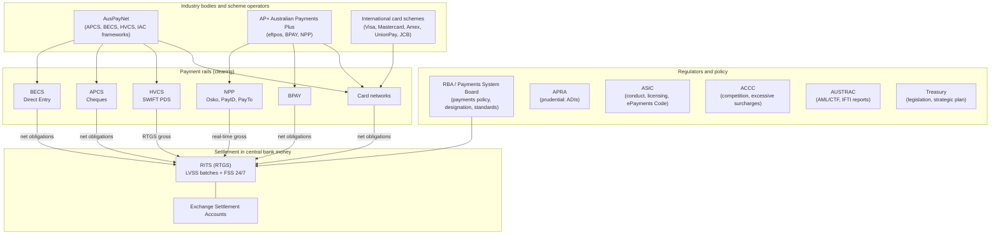

**Key ideas**

- **Clearing** happens on many rails, operated by different bodies.
- **Settlement** of interbank obligations nearly always ends in **RITS**, the RBA's real-time gross settlement system, across banks' **Exchange Settlement Accounts (ESAs)**.
- **AP+** (Australian Payments Plus) was formed in 2022 by bringing together **eftpos**, **BPAY Group** and **NPP Australia**.
- **AusPayNet** (Australian Payments Network) is the industry self-regulatory body. It manages the clearing frameworks for cheques (APCS), direct entry (BECS), high-value payments (HVCS) and card/ATM interoperability (IAC).

---

## 3. Core concepts every payment shares

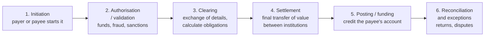

| Concept | Meaning | Australian example |
|---|---|---|
| **Push vs pull** | *Push*: the payer instructs their bank to send money (credit transfer). *Pull*: the payee draws money from the payer's account under an authority (debit transfer). | Push: Osko, direct credit, BPAY. Pull: direct debit, card payments, PayTo (payee-initiated, but executed as a push from the payer's bank). |
| **Clearing vs settlement** | Clearing = exchanging payment details and working out who owes whom. Settlement = discharging those obligations by moving money. | BECS files are exchanged (clearing) and then settled in RITS batches (settlement). |
| **Gross vs net** | *Gross*: each payment settles on its own. *Net (DNS)*: obligations are offset and only the net amount moves. | RTGS/HVCS and NPP are gross. Cards, BECS, BPAY and cheques settle net. |
| **Real-time vs deferred** | Whether interbank settlement happens at the same moment as the payment or later. | NPP: real time, 24/7. BECS: several intraday batches. Cards: usually next business day. |
| **Finality** | The point when a transfer can no longer be reversed. | Settlement in RITS is final and irrevocable (protected by the *Payment Systems and Netting Act 1998*). |
| **Credit vs settlement risk** | The risk that a counterparty fails before it has paid. Net and deferred systems carry more of it. | Reduced by RTGS, prefunding, collateral and loss-sharing rules. |
| **Central bank money vs commercial bank money** | Balances at the RBA (ESAs) vs deposits held at commercial banks. | Your account balance is commercial bank money. Banks settle with each other in ESA balances. |

---

## 4. Settlement infrastructure: RITS, ESAs and the RBA

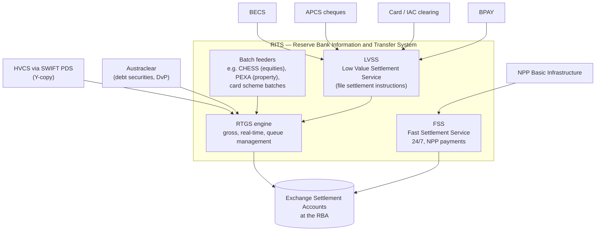

- **ESA (Exchange Settlement Account):** an account at the RBA used to settle interbank obligations. Holders are mainly ADIs, plus some other approved entities. Institutions without an ESA settle through a **sponsor** or **agent** bank (for example Cuscal or Indue for many credit unions and fintechs).
- **RTGS (Real-Time Gross Settlement):** each payment settles one by one, in central bank money, if the payer bank has enough ESA balance. Payments that cannot settle are **queued**.
- **LVSS (Low Value Settlement Service):** takes File Settlement Instructions (FSIs) for low-value clearings (BECS, cheques, card and ATM obligations, BPAY) and settles them in RITS in scheduled multilateral net batches.
- **FSS (Fast Settlement Service):** settles each NPP payment individually and in real time, 24/7/365, against a dedicated ESA allocation.
- **Intraday liquidity:** banks obtain ESA funds intraday through **repurchase agreements (repos)** with the RBA, and hold liquidity for after-hours FSS settlement.
- **Open RTGS:** RITS opens hours on business days for HVCS and batches, while FSS runs continuously.

---

## 5. Card payments

### 5.0 Card terms you need first

| Term | Definition |
|---|---|
| **Cardholder** | The person the card is issued to. |
| **Issuer** | The bank or institution that issues the card, holds the account or credit line, approves transactions and bears the cardholder's credit and fraud risk. |
| **Merchant** | The business accepting the card. |
| **Acquirer** | The institution that contracts with the merchant, routes its transactions to the schemes and pays out the merchant. Examples: major banks, Tyro, Adyen, Stripe (as PSP/PayFac on top of acquirers). |
| **Card scheme / network** | The organisation that sets rules and runs the switch connecting acquirers to issuers: Visa, Mastercard, eftpos (AP+), Amex, UnionPay, JCB. |
| **Four-party scheme** | A scheme where issuer and acquirer are different institutions (Visa, Mastercard, eftpos). |
| **Three-party scheme** | The scheme itself is both issuer and acquirer (traditional Amex, Diners). |
| **PSP / Payment facilitator (PayFac)** | A provider that onboards many small merchants under its own master merchant agreement with an acquirer (for example Square, Stripe). |
| **Payment gateway** | The service between the merchant and the acquirer. For online payments it captures and tokenises the card, runs 3-D Secure, sends authorisations, handles capture, voids, refunds, reversals and retries, and produces payout reports. In store, a POS gateway or terminal host connects terminals and integrated POS systems to one or more acquirers using AS 2805. |
| **AS 2805** | The Australian standard for card and EFT messages, based on ISO 8583. Used between terminals, gateways, acquirers, eftpos and issuers, including key management and message authentication (MAC). |
| **Dual vs single message** | *Dual message*: authorisation (`0100`) is separate from clearing (a batch file). Used for credit and most scheme debit. *Single message*: one `0200` both authorises and creates the financial record. Used by eftpos and ATMs. |
| **Terminal / POS** | The device that reads the card (EMV chip, contactless, or swipe). |
| **Interchange fee** | A fee paid by the acquirer to the issuer on each transaction in four-party schemes. It is regulated by RBA standards. |
| **Scheme fees** | Fees the scheme charges issuers and acquirers for using the network. |
| **Merchant Service Fee (MSF)** | The total fee the acquirer charges the merchant. MSF ≈ interchange + scheme fees + acquirer margin. |
| **Surcharge** | An extra amount a merchant adds for paying by card, which RBA rules limit to the merchant's cost of acceptance. (Removal for eftpos, Mastercard and Visa was proposed in the RBA's 2025 review. Check the current standard.) |
| **Authorisation** | The real-time request to the issuer to approve the purchase and place a **hold** on funds or credit. |
| **Clearing (cards)** | Sending the finalised transaction record (usually in an end-of-day batch) through the scheme so the issuer can post it. |
| **Settlement (cards)** | Moving the net amounts between issuers and acquirers, typically next business day, through RITS. |
| **Funding / payout** | The acquirer paying the merchant (same day, next day or T+2, depending on provider). |
| **Chargeback** | A forced reversal initiated by the issuer under scheme rules (for fraud, non-delivery, duplicate charge, and so on). |

### 5.1 Four-party credit card (in store)

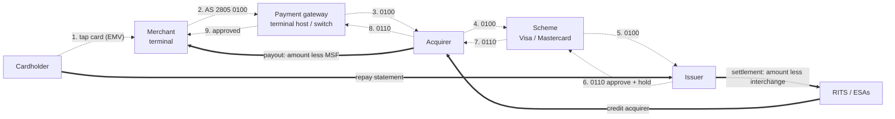

#### Lifecycle

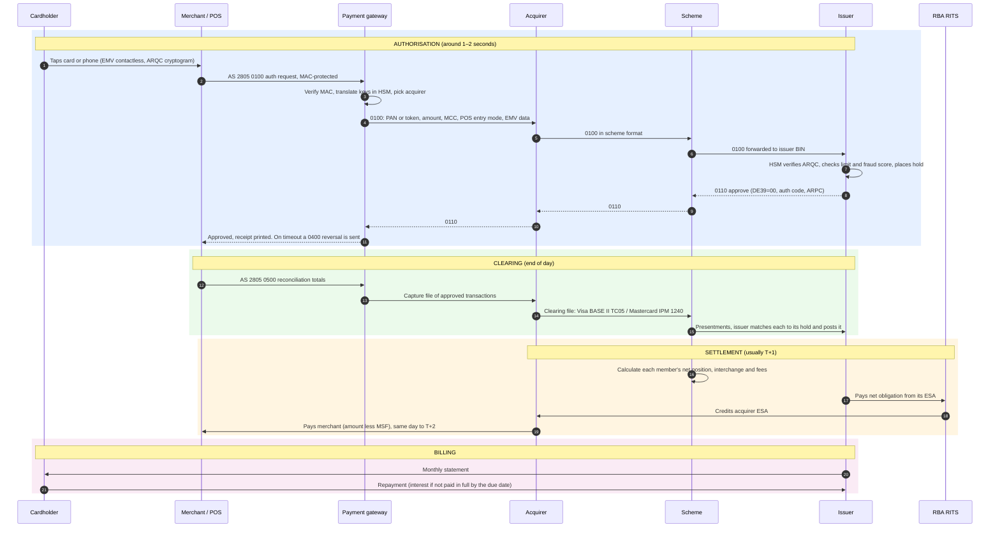

#### Who earns what (illustrative $100 credit card purchase)

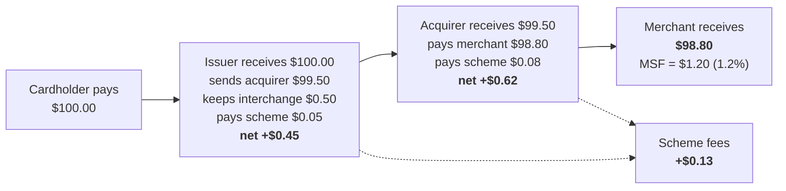

| Party | Revenue source on this transaction |
|---|---|
| Issuer | Interchange; also interest, annual fees, late fees, FX fees (outside this transaction) |
| Scheme | Scheme fees from both sides, plus cross-border and value-added service fees |
| Acquirer / PSP | MSF less interchange and scheme fees, plus terminal rental |
| Merchant | Pays the MSF; may recover it through a surcharge where permitted |

> **Interchange regulation.** RBA standards set weighted-average interchange benchmarks and per-transaction caps for designated schemes (historically 0.5% weighted average and a 0.8% cap for credit; 8 cents weighted average and a cap of 10 cents or 0.2% for debit and prepaid). The 2024–25 review proposed lower caps. Check the current standard.

### 5.2 Dual-network debit and least-cost routing

Most Australian debit cards are **dual-network debit cards (DNDCs)**: one card carries both **eftpos** and **Visa Debit** or **Debit Mastercard**. For a contactless or online transaction, the merchant's acquirer can choose which network to use.

**Least-cost routing (LCR)**, also called *merchant-choice routing*, sends the transaction over the cheaper network for the merchant, which is often eftpos. The RBA expects acquirers to offer LCR, and expects large issuers to issue dual-network cards.

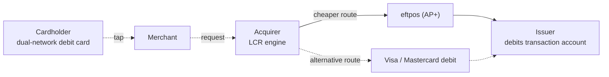

**Differences from credit:**

- Funds come straight from the cardholder's **transaction account**. There is no credit line, so the issuer bears less credit risk.
- Interchange is usually a **flat cents amount** per transaction, not a percentage.
- At the checkout, choosing **CHQ/SAV** (inserted card) forces the eftpos network; choosing **CR** forces the international network.
- Cash-out at the checkout is an eftpos feature.

### 5.3 Card-not-present (online), gateways, 3-D Secure and tokens

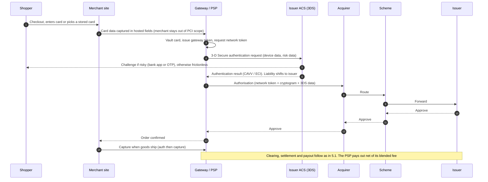

| Term | Definition |
|---|---|
| **CNP (card-not-present)** | Online, in-app, phone or mail order transactions. Fraud risk is higher, so interchange is often higher too. |
| **PCI DSS** | The Payment Card Industry Data Security Standard. It governs anyone who stores, processes or transmits card data. |
| **Gateway token** | A substitute for the card number, held in a PSP's vault and usable only with that PSP. |
| **Network (EMV payment) token** | A scheme-issued substitute PAN, created by a token service such as Visa Token Service, Mastercard MDES or the eftpos token service. It stays valid when the plastic card is reissued. |
| **3-D Secure (3DS / EMV 3DS)** | An authentication protocol that lets the issuer verify the shopper. The issuer's **Access Control Server (ACS)** decides between a frictionless flow and a challenge. A successful authentication generally shifts fraud liability to the issuer. |
| **Auth / capture** | Reserve funds at order time, then *capture* (finalise) when goods ship. An uncaptured authorisation expires. |
| **Card-on-file / MIT** | Stored credentials used for merchant-initiated transactions such as subscriptions. |
| **SCA / strong authentication** | Multi-factor authentication. Australia relies on industry CNP fraud thresholds set by AusPayNet rather than an EU-style mandate. |

### 5.4 Three-party schemes (Amex, Diners)

In a three-party scheme there is **no separate issuer and acquirer** and so no interchange. The scheme charges the merchant a discount rate and serves the cardholder directly. (Amex also has "issuer partner" arrangements with some banks, which behave more like four-party arrangements.)

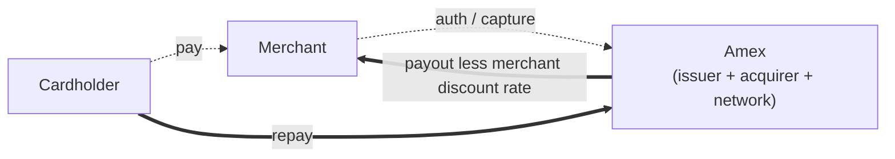

### 5.5 Disputes and chargebacks

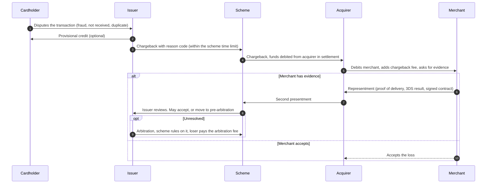

- **Issuer** recovers the money from the acquirer.
- **Acquirer** recovers it from the merchant. If the merchant has failed, the acquirer bears the loss, which is why acquirers hold **reserves** or delay payouts for risky merchants.
- **Friendly fraud** is a dispute raised by a genuine cardholder who made the purchase.
- Separate from chargebacks, the **ePayments Code** (ASIC) sets rules for unauthorised transactions and mistaken payments.

### 5.6 Digital wallets

Apple Pay, Google Pay, Samsung Pay and Garmin Pay are **not separate payment networks**. They store a **network token** of a card on the device and use biometric authentication (CDCVM). The transaction then runs on the card rails as in 5.1 and 5.2. The wallet provider may charge the issuer a fee. The *Treasury Laws Amendment (Payments System Modernisation) Act* extends the RBA's and Treasury's powers to cover such providers.

---

## 6. Direct Entry / BECS

**BECS (Bulk Electronic Clearing System)**, also called **Direct Entry**, is the batch system used for payroll, government benefits, supplier payments and direct debits. It is governed by AusPayNet. Payments are addressed by **BSB + account number** and submitted in **ABA (Cemtex)** files. AP+ and the industry plan to migrate BECS volumes to the NPP. Check AusPayNet for the current timeline.

| Term | Definition |
|---|---|
| **BSB** | Bank-State-Branch: a 6-digit code identifying the institution and branch. |
| **ABA / Cemtex file** | The fixed-width file format used to submit bulk direct entry payments. |
| **Direct Entry User ID (APCA User ID)** | A 6-digit ID that identifies a business allowed to submit direct entry files, especially debits. |
| **Sponsor bank** | The ADI that sponsors a business into BECS, and is liable for the debits it submits. |
| **Direct credit** | A push payment: the payer's bank sends money to many payees, for example payroll. |
| **Direct debit** | A pull payment: the payee (biller) draws money from the payer's account under a signed **Direct Debit Request (DDR)**. |
| **Dishonour / return** | An item rejected by the receiving bank, for example insufficient funds, closed account or invalid BSB. |
| **COIN** | Community of Interest Network: the private network banks use to exchange BECS files bilaterally. |
| **Confirmation of Payee** | An industry service (rolled out from 2025) that checks the account name against the BSB and account number before a payment is sent, to reduce scams and mistakes. |

### 6.1 Direct credit (payroll)

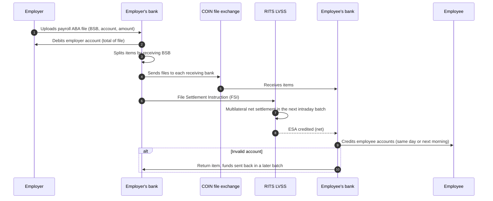

### 6.2 Direct debit

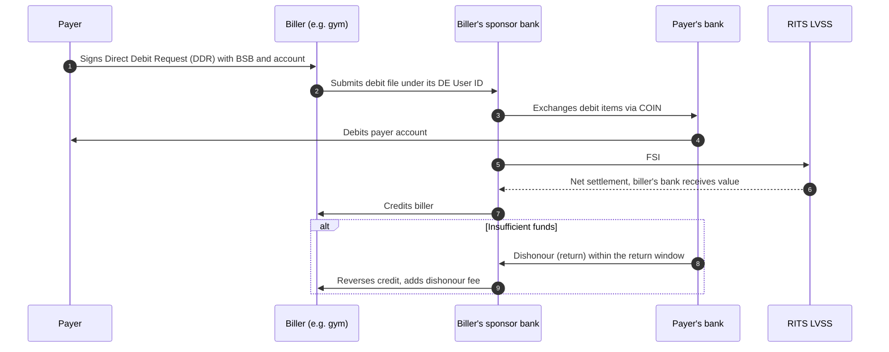

**Value chain:** banks charge businesses per-item or per-file fees, and dishonour fees. There is no interchange. Billers carry dishonour and reconciliation costs, which is one reason PayTo exists.

---

## 7. NPP (New Payments Platform)

The **NPP** launched in February 2018 and is operated by AP+. It is Australia's **real-time, 24/7, data-rich** account-to-account infrastructure. Payments clear in seconds and **settle individually in central bank money** through the RBA's **FSS**.

| Term | Definition |
|---|---|
| **NPP Basic Infrastructure (BI)** | The central switch connecting participants' Payment Access Gateways (PAGs). It routes ISO 20022 messages. |
| **Overlay service** | A service built on the NPP with its own rules, for example **Osko** (by BPAY), **PayTo** and international inbound. |
| **Osko** | The overlay for fast person-to-person and business payments, with a guaranteed speed of under a minute (usually a few seconds). |
| **PayID** | An easy-to-remember alias (mobile number, email, ABN/ACN or Organisation ID) linked to a BSB and account in the NPP **Addressing Service**. When looked up, it shows the payee's name before you pay. |
| **PayTo** | The NPP's mandated payments service. A payee (merchant) asks for a **payment agreement** (mandate). The payer approves it in their banking app and can pause or cancel it there. The payee then initiates payments, which execute as real-time NPP credits. It is the modern replacement for direct debit. |
| **Mandate Management Service (MMS)** | The central store of PayTo agreements. |
| **Payment initiator** | The business (or its PSP) that initiates PayTo payments under an agreement. |
| **ISO 20022** | The global XML message standard. The NPP uses `pacs.008` (credit transfer), `pacs.002` (status), `pain.013` (payment initiation request) and others, with up to 280 characters of remittance information. |
| **Connected institution / identified institution** | Non-ADIs (fintechs) connecting through an NPP participant or overlay. |

### 7.1 Osko payment to a PayID

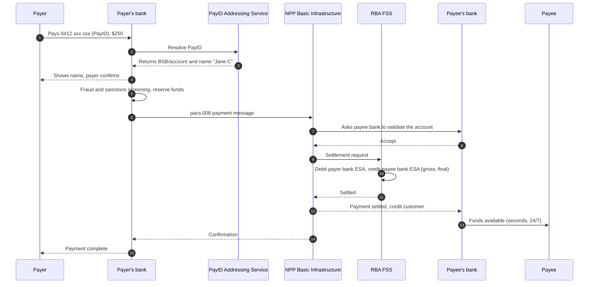

### 7.2 PayTo

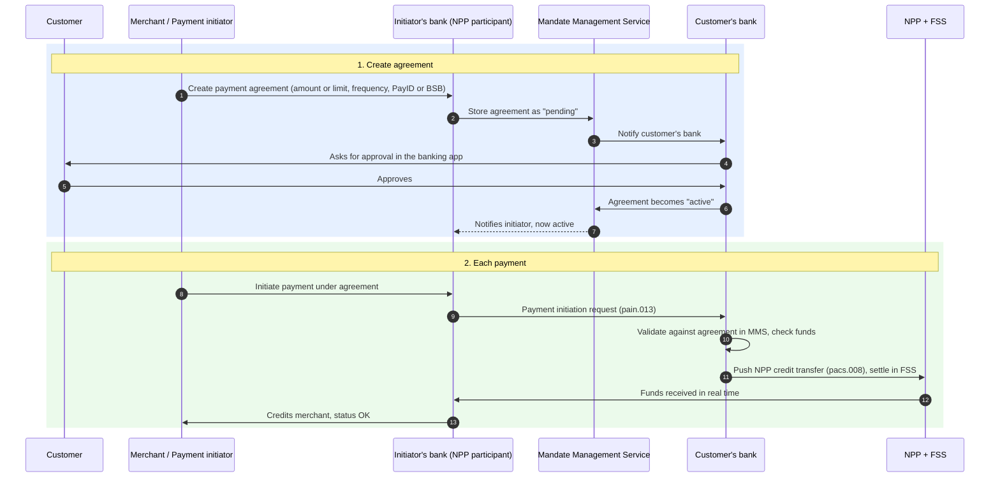

**Value chain:** banks and PSPs charge per-payment fees, usually cents. There is no interchange, which makes it cheaper than cards for many billers. Overlay operators earn wholesale fees from participants.

---

## 8. BPAY

**BPAY** (operated by AP+) is a bill payment scheme. Customers pay billers from internet banking using a **Biller Code** and **Customer Reference Number (CRN)**.

| Term | Definition |
|---|---|
| **Biller Code** | Identifies the biller, which also determines the biller's bank. |
| **CRN** | Customer Reference Number. It identifies the customer at the biller and includes check digits, so the bank can validate it before the payment is accepted. |
| **BPAY View** | A legacy e-billing feature (bills shown in internet banking). |
| **Osko** | BPAY Group's NPP overlay (see section 7). |

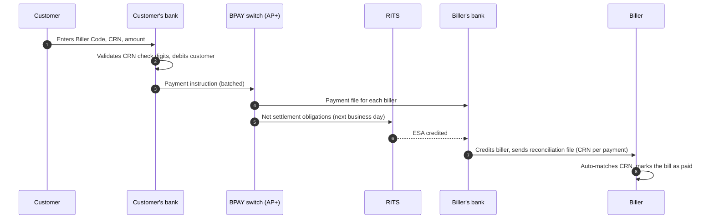

**Value chain:** the biller pays its bank a per-transaction fee. Payers usually pay nothing. Banks pay BPAY scheme fees. The CRN makes reconciliation cheap for billers.

---

## 9. Cheques (APCS)

The **Australian Paper Clearing System (APCS)**, managed by AusPayNet, clears cheques using **image exchange**. Cheque use has collapsed. The Government and industry have agreed a plan to wind cheques down; the published transition plan stops new cheque issuance and then acceptance by about the end of the decade. Check AusPayNet for the current dates.

| Term | Definition |
|---|---|
| **Drawer** | The person who writes the cheque. |
| **Drawee bank** | The drawer's bank, on which the cheque is drawn. |
| **Payee** | The person named on the cheque. |
| **Collecting bank** | The payee's bank, which collects the funds. |
| **MICR line** | The magnetic ink line printed on the cheque, containing the cheque number, BSB and account. |
| **Clearance period** | The time before deposited funds are available (traditionally about 3 business days), allowing time for a possible dishonour. |
| **Dishonour** | A refusal to pay because of insufficient funds, a stop payment or an irregularity. |

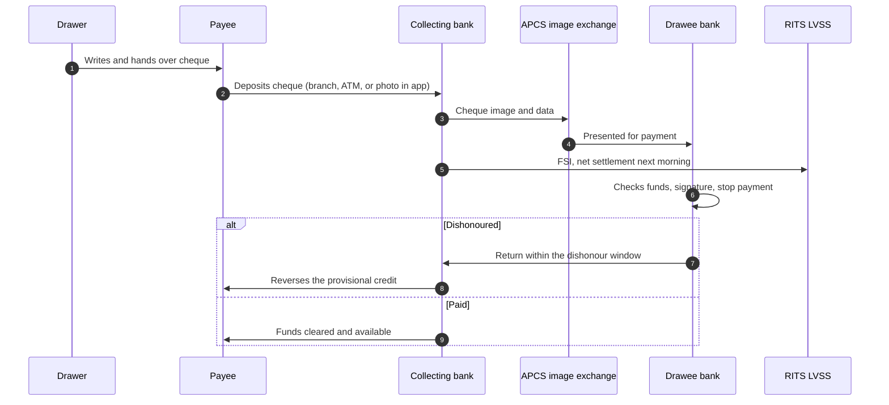

---

## 10. High-value payments (HVCS / RTGS)

The **High Value Clearing System (HVCS)** carries large, time-critical payments between banks, such as corporate treasury payments, interbank loans, FX settlements and property settlements. Messages travel over **SWIFT** (migrated to **ISO 20022**) and each payment settles **gross and in real time** in RITS using the **SWIFT PDS Y-copy** model.

| Term | Definition |
|---|---|
| **RTGS** | Real-Time Gross Settlement. |
| **SWIFT PDS** | The SWIFT Payment Delivery System used for HVCS. |
| **Y-copy** | SWIFT holds the payment message, sends a copy of the settlement details to RITS, and releases the full message to the beneficiary bank only after RITS confirms settlement. |
| **Queue / liquidity management** | A payment is queued in RITS until the paying bank has enough ESA funds. |
| **PEXA** | The electronic conveyancing platform. Property settlement funds settle through a RITS batch so that title transfer and payment happen together. |
| **Austraclear / CHESS** | ASX systems for settling debt securities and equities. Their cash legs settle in RITS (delivery versus payment, DvP). |
| **CLS** | Continuous Linked Settlement: a global system for settling FX trades payment versus payment. AUD is a CLS currency, and CLS holds an ESA. |

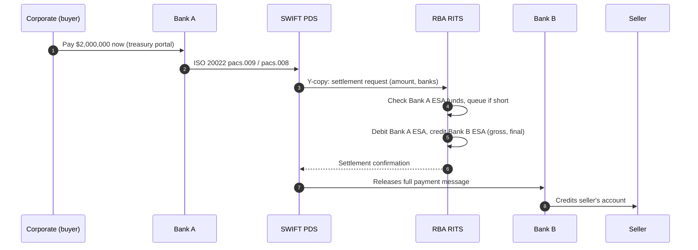

---

## 11. International payments

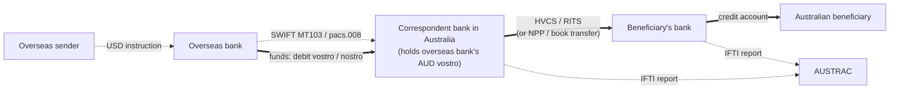

| Term | Definition |
|---|---|
| **Correspondent banking** | Banks hold accounts with each other in different currencies so they can make cross-border payments. |
| **Nostro / vostro** | *Nostro*: "our account at your bank" (in your currency). *Vostro*: "your account at our bank". |
| **SWIFT** | The global secure messaging network. It moves messages, not money. |
| **SWIFT gpi** | A tracking and service-level standard for cross-border payments (UETR tracking reference). |
| **MT103 / pacs.008** | The customer credit transfer message, in legacy MT format and ISO 20022 format. |
| **Charges: OUR / SHA / BEN** | Who pays fees: the sender pays all (OUR), the fees are shared (SHA), or the beneficiary pays all (BEN, deducted from the amount). |
| **FX spread** | The margin between the wholesale exchange rate and the customer rate. It is often the main revenue in international payments. |
| **IFTI** | International Funds Transfer Instruction: a report that must be lodged with AUSTRAC for transfers into or out of Australia. |
| **Remittance provider** | A non-bank money transfer service (registered with AUSTRAC), for example Wise. Such providers often pay out through local rails such as the NPP. |

**Value chain:** sending bank fees, correspondent lifting fees, the FX spread, and receiving bank fees. Many providers route via local rails at both ends ("pre-funded pools") to avoid correspondent chains.

---

## 12. Buy Now Pay Later (BNPL)

BNPL providers (Afterpay, Zip, Klarna, PayPal Pay in 4) pay the merchant up front, less a fee, and collect from the shopper in instalments. Low-cost BNPL has been regulated as credit under the *National Consumer Credit Protection Act* since 10 June 2025 (lighter responsible lending obligations, and a credit licence is required).

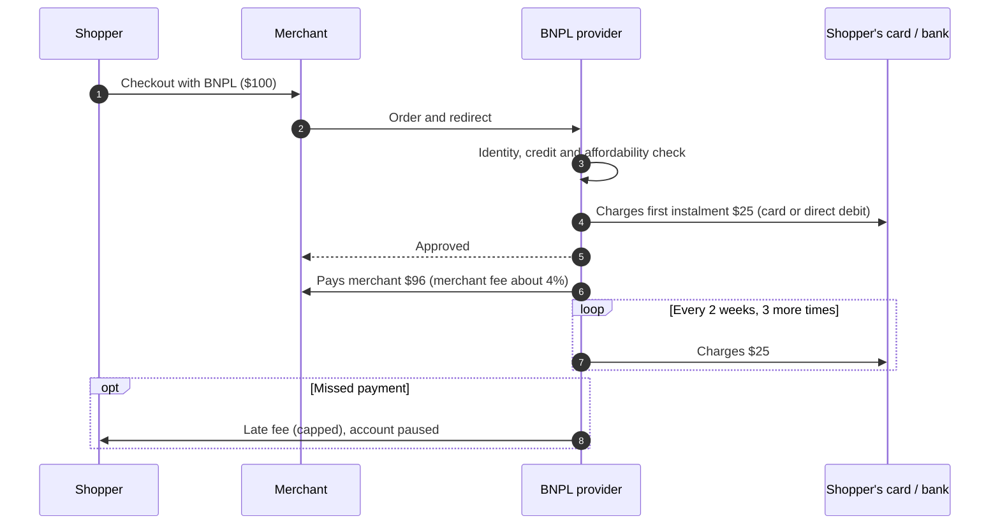

**Value chain:** the merchant fee (much higher than card MSF) is the main revenue, plus late fees. Card fees paid by the BNPL provider on instalments are a cost. BNPL funds the receivable with warehouse debt facilities.

---

## 13. Cash and ATMs

| Term | Definition |
|---|---|
| **IAC** | Issuers and Acquirers Community (AusPayNet). It governs card and ATM interoperability, security and the ATM Access Regime. |
| **ATM direct charging** | Since 2009 the ATM owner charges the cardholder directly, and this must be disclosed on screen. The major banks have since removed fees for their own customers at their ATMs. |
| **Cash-in-transit (CIT)** | Armoured logistics companies that move cash between the RBA, banks, ATMs and retailers. |
| **Cash distribution** | The RBA issues banknotes, and banks and CIT firms distribute them. Declining cash use is putting pressure on the economics of distribution. |
| **Cash-out** | Getting cash at the point of sale using eftpos. |

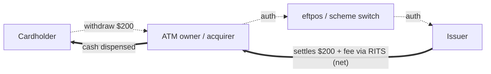

---

## 14. Side-by-side comparison

| Rail | Push / pull | Addressing | Speed to payee | Interbank settlement | Availability | Typical cost bearer | Main uses |
|---|---|---|---|---|---|---|---|
| Credit card (Visa/MC) | Pull | Card number / token | Approval instant; payout T+0 to T+2 | Net, about T+1, RITS | 24/7 auth | Merchant (MSF) | Retail, online, travel |
| Debit (eftpos / DNDC) | Pull | Card / token | Same | Net, RITS | 24/7 auth | Merchant (lower MSF with LCR) | Everyday retail |
| Amex | Pull | Card | Payout per contract | Internal (three-party) | 24/7 | Merchant | Premium spending |
| BECS direct credit | Push | BSB + account | Same / next business day | Net, intraday batches, LVSS | Business days | Payer business | Payroll, benefits, suppliers |
| BECS direct debit | Pull | BSB + account + DDR | 1–3 days with dishonour risk | Net, LVSS | Business days | Biller | Subscriptions, loans, utilities |
| NPP / Osko | Push | PayID or BSB + account | Seconds | **Gross, real time, FSS** | **24/7/365** | Low per-item (banks) | P2P, business, payroll |
| PayTo | Pull-initiated, push-executed | Agreement + PayID / BSB | Seconds | Gross, FSS | 24/7 | Payee (cents) | Subscriptions, wallets, top-ups |
| BPAY | Push | Biller Code + CRN | Next business day | Net, RITS | Batch | Biller | Bills, tax, council rates |
| Cheque | Pull (paper) | MICR line | About 3 days | Net, LVSS | Business days | Mixed | Legacy, being wound down |
| HVCS | Push | BIC + account | Minutes | **Gross RTGS** | RITS hours | Payer bank / corporate | Treasury, property, FX |
| International (SWIFT) | Push | BIC + IBAN / account | Hours to days | Via correspondents | Varies | Sender / receiver (fees + FX) | Trade, remittance |
| BNPL | Pull (instalments) | Account with provider | Merchant paid per contract | Provider's banking rails | 24/7 | Merchant (high fee) | Retail checkout |

---

## 15. Regulation, risk and consumer protection

| Area | Instrument / body | Notes |
|---|---|---|
| Payments policy | **Payment Systems (Regulation) Act 1998**, RBA Payments System Board | RBA can *designate* a system and set standards (interchange, surcharging, access). Expanded by the Payments System Modernisation legislation (2024) to cover new entrants such as digital wallets. |
| Finality | **Payment Systems and Netting Act 1998** | Protects RTGS finality and netting if a participant becomes insolvent. |
| Prudential | **APRA** | Licenses and supervises ADIs. Stored-value facility regulation is being reformed under the payments licensing package. |
| Conduct | **ASIC**, *Corporations Act* (AFSL for non-cash payment facilities), **ePayments Code** | Unauthorised transactions, mistaken internet payments, disclosure. |
| Credit | *National Consumer Credit Protection Act* | Credit cards, and BNPL since June 2025. |
| AML/CTF | **AUSTRAC**, AML/CTF Act (Tranche 2 reforms) | Customer due diligence, IFTI and threshold transaction reports (cash of $10,000 or more), suspicious matter reports. |
| Competition | **ACCC** | Excessive surcharging enforcement and merger review. |
| Scams | *Scams Prevention Framework Act 2025*, Confirmation of Payee, Scam-Safe Accord | Obligations on banks, telcos and digital platforms. |
| Data | **Consumer Data Right** (Open Banking), Privacy Act | Data sharing and action initiation (planned). |
| Security | PCI DSS, AusPayNet IAC Code (card PIN/terminal security), CNP fraud mitigation framework | |

**Key risks in the value chain**

| Risk | Where it sits | Mitigation |
|---|---|---|
| Credit risk | Issuer (credit card), BNPL provider | Credit assessment, limits |
| Settlement risk | Banks in deferred net systems | RTGS, collateral, settlement shortly after clearing |
| Liquidity risk | ESA holders | Intraday repos, queue management, FSS prefunding |
| Fraud risk | Issuer (CP), merchant (CNP without 3DS) | EMV, tokens, 3DS, behavioural analytics |
| Merchant failure | Acquirer (future chargebacks for undelivered goods) | Reserves, delayed payouts, monitoring |
| Operational risk | All participants | Resilience standards (APRA CPS 230), RBA oversight |
| Scams (authorised push payment) | Payer's bank, receiving bank | PayID name display, Confirmation of Payee, delays on risky payments |

---

## 16. Glossary (A–Z)

| Term | Definition |
|---|---|
| **ABA file** | Fixed-width bulk file format for direct entry payments (also called a Cemtex file). |
| **ACCC** | Australian Competition and Consumer Commission. |
| **Access regime** | Rules for how new participants can join a payment system (for example the ATM Access Regime). |
| **Acquirer** | Institution that signs up merchants to accept cards and settles funds to them. |
| **ACS** | Access Control Server: the issuer's 3-D Secure authentication server. |
| **ADI** | Authorised Deposit-taking Institution (bank, building society or credit union) licensed by APRA. |
| **Addressing Service** | The NPP database mapping PayIDs to accounts. |
| **AFSL** | Australian Financial Services Licence (ASIC). |
| **AP+** | Australian Payments Plus: the operator of eftpos, BPAY and the NPP. |
| **APCS** | Australian Paper Clearing System (cheques). |
| **APRA** | Australian Prudential Regulation Authority. |
| **ASIC** | Australian Securities and Investments Commission. |
| **Auth code** | The approval code returned by the issuer. |
| **Authorisation** | Issuer approval of a card transaction in real time, with a hold on funds. |
| **Austraclear** | The ASX system for settling debt securities. |
| **AusPayNet** | Australian Payments Network: the industry self-regulatory body for payments. |
| **AUSTRAC** | Australian Transaction Reports and Analysis Centre (AML/CTF regulator and FIU). |
| **BECS** | Bulk Electronic Clearing System (direct entry). |
| **BIC** | Bank Identifier Code (SWIFT code). |
| **BIN / IIN** | Bank or Issuer Identification Number: the first 6–8 digits of a card number. |
| **BNPL** | Buy Now Pay Later. |
| **BPAY** | Bill payment scheme operated by AP+. |
| **BSB** | Bank-State-Branch number (6 digits). |
| **Capture** | Finalising an authorised card transaction for clearing. |
| **Card-not-present (CNP)** | A transaction where the card isn't physically presented. |
| **CDCVM** | Consumer Device Cardholder Verification Method: biometric or passcode on a phone. |
| **Chargeback** | An issuer-initiated reversal of a card transaction under scheme rules. |
| **CHESS** | ASX Clearing House Electronic Subregister System (equities). |
| **Clearing** | Exchanging payment information and calculating obligations. |
| **CLS** | Continuous Linked Settlement for FX. |
| **COIN** | Community of Interest Network for bilateral file exchange. |
| **Confirmation of Payee** | A check that the account name matches the BSB and account. |
| **Correspondent bank** | A bank that provides accounts and payment services to another bank in a foreign currency. |
| **CRN** | Customer Reference Number (BPAY). |
| **Cryptogram** | A one-time code generated by an EMV chip or token for each transaction. |
| **DDR** | Direct Debit Request: the authority a payer signs. |
| **Designation** | An RBA power to bring a payment system under regulation. |
| **Direct credit / debit** | Push / pull payments in BECS. |
| **Dishonour** | Rejection of a debit or cheque, for example for insufficient funds. |
| **DNDC** | Dual-network debit card. |
| **DNS** | Deferred Net Settlement. |
| **DvP** | Delivery versus Payment. |
| **eftpos** | The Australian domestic debit card scheme (AP+). |
| **EMV** | The chip card standard (Europay, Mastercard, Visa), now run by EMVCo. |
| **ePayments Code** | ASIC code for electronic payments: unauthorised and mistaken transactions. |
| **ESA** | Exchange Settlement Account at the RBA. |
| **Finality** | The point at which a payment is irrevocable. |
| **FSI** | File Settlement Instruction (LVSS). |
| **FSS** | Fast Settlement Service: RITS's 24/7 settlement of NPP payments. |
| **Funding** | The acquirer paying the merchant. |
| **Gateway** | Software connecting online merchants to acquirers. |
| **HVCS** | High Value Clearing System (SWIFT PDS). |
| **IAC** | Issuers and Acquirers Community (AusPayNet). |
| **IFTI** | International Funds Transfer Instruction report to AUSTRAC. |
| **Interchange** | A fee paid between acquirer and issuer in four-party schemes. |
| **ISO 8583** | The message standard for card authorisations. |
| **ISO 20022** | The XML message standard for account-to-account payments (NPP, HVCS). |
| **Issuer** | The institution that issues a card or holds the payer's account. |
| **LCR** | Least-cost routing (merchant-choice routing). |
| **Liability shift** | Moving fraud liability from merchant to issuer after successful 3DS or EMV. |
| **LVSS** | Low Value Settlement Service (RITS). |
| **Mandate** | An authority to debit, such as a PayTo agreement or DDR. |
| **MCC** | Merchant Category Code. |
| **MDR / MSF** | Merchant Discount Rate / Merchant Service Fee. |
| **MICR** | Magnetic Ink Character Recognition line on a cheque. |
| **MMS** | Mandate Management Service (PayTo). |
| **Net settlement** | Settling only the net difference of offsetting obligations. |
| **Nostro / vostro** | "Our account with you" / "your account with us". |
| **NPP** | New Payments Platform. |
| **Osko** | NPP overlay for fast payments (BPAY Group). |
| **Overlay service** | A service built on top of the NPP's basic infrastructure. |
| **PAN** | Primary Account Number (the card number). |
| **PayFac** | Payment facilitator: a master merchant aggregating sub-merchants. |
| **PayID** | An NPP alias for an account (phone, email, ABN, Org ID). |
| **PayTo** | The NPP mandated payments service. |
| **PCI DSS** | Payment Card Industry Data Security Standard. |
| **PEXA** | The electronic property settlement platform. |
| **Presentment** | Submission of a captured card transaction for clearing. |
| **PSB** | Payments System Board (RBA). |
| **PSP** | Payment Service Provider. |
| **RBA** | Reserve Bank of Australia. |
| **Representment** | A merchant's challenge to a chargeback, with evidence. |
| **Repo** | Repurchase agreement: how banks borrow intraday ESA liquidity from the RBA. |
| **RITS** | Reserve Bank Information and Transfer System (Australia's RTGS). |
| **RTGS** | Real-Time Gross Settlement. |
| **Scheme fee** | A fee charged by the card network to issuers and acquirers. |
| **Settlement** | The final transfer of value that discharges obligations. |
| **Sponsor bank** | A bank that provides another entity access to a payment system. |
| **Surcharge** | An extra fee added for card payments. |
| **SWIFT** | Society for Worldwide Interbank Financial Telecommunication. |
| **3-D Secure** | Online card authentication protocol. |
| **Token / tokenisation** | Replacing a PAN with a surrogate value (gateway or network token). |
| **TSP** | Token Service Provider. |
| **UETR** | Unique End-to-end Transaction Reference (SWIFT gpi). |
| **Y-copy** | SWIFT model where the settlement copy goes to RITS before the message is released. |

---

## 17. Inside the bank: how a payment is processed

The diagrams above treat each bank as one box. Inside, a payment passes through a chain of systems. The interactive player has three scenarios that animate these steps: **Inside the issuer**, **Outbound payment** and **Inbound payment**.

### 17.1 Outbound (sending bank), for example an NPP payment

```mermaid
flowchart LR
  C["Customer"] -->|"app API"| CH["Digital channel<br/>MFA, step-up"]
  CH -->|"pain.001 (canonical)"| HUB["Payment hub<br/>validate, enrich,<br/>rail selection"]
  HUB <-->|"score"| FR["Fraud engine<br/>scams, mules"]
  HUB <-->|"screen"| SA["Sanctions and AML"]
  HUB <-->|"debit / hold"| CORE["Core banking"]
  HUB <-->|"position"| TR["Treasury<br/>ESA / FSS liquidity"]
  HUB -->|"payment"| PAG["NPP gateway (PAG)<br/>build + sign pacs.008"]
  PAG -->|"pacs.008"| NPP["NPP + RBA FSS"]
  NPP -->|"pacs.002 ACSC / RJCT"| PAG
  HUB -->|"journals"| GL["General ledger<br/>suspense, ESA recon"]
  HUB -->|"status, camt.054"| CH
```

| # | Step | System | What happens | Messages / data |
|---|---|---|---|---|
| 1 | Capture | Digital channel / host-to-host | Customer authenticates (biometric, MFA) and creates the payment. Corporates upload files. | App API, `pain.001` |
| 2 | Technical validation | Payment hub | Schema, mandatory fields, character set, duplicate check (EndToEndId, amount, payee, time window) | |
| 3 | Business validation | Payment hub | BSB valid (AusPayNet BSB directory), account status, limits, cut-off times, entitlements | |
| 4 | Enrichment | Payment hub | Resolve PayID and show the payee name (Confirmation of Payee), add BIC and clearing codes, purpose codes, charges | NPP Addressing Service lookup |
| 5 | Rail selection | Payment hub | NPP if the payee is reachable and the payment is real-time eligible, else BECS (batch) or HVCS (high value or urgent), or SWIFT for cross-border | |
| 6 | Fraud and scam screening | Fraud engine | Real-time model: new payee, device, behavioural biometrics, amount versus history, mule intelligence. May hold, warn or call the customer | Score API |
| 7 | Sanctions and AML | Screening engine | Names against the DFAT Consolidated List and other lists; AML transaction monitoring | Screening API |
| 8 | Funds control | Core banking | Check available balance and overdraft, debit the customer, credit the outward suspense GL | Debit posting |
| 9 | Liquidity | Treasury | Check the FSS allocation or ESA position, queue if short, top up from RITS (repo) | |
| 10 | Message build and send | Gateway (NPP PAG / SWIFT / BECS file) | Map to ISO 20022, sign with HSM keys, send | `pacs.008` / `pacs.009` / ABA file |
| 11 | Status | Payment hub | Receive accept, settled or rejected | `pacs.002` (ACSC / RJCT + reason) |
| 12 | Accounting | General ledger | Dr outward suspense, Cr ESA settlement account | Journal |
| 13 | Notification | Channel | Push notification, receipt, corporate status | `camt.054`, `pain.002` |
| 14 | End of day | Ops / finance | Reconcile ESA (RITS reports) versus GL versus hub, investigate breaks, regulatory reporting (AUSTRAC SMR / TTR / IFTI where relevant), statements | `camt.053` |
| 15 | Exceptions | Payment hub / ops | Reject: reverse the debit. Recall: send `camt.056` and receive `camt.029`. Returned funds arrive by `pacs.004` | |

### 17.2 Inbound (receiving bank)

1. **Receive** `pacs.008` from the NPP (or HVCS/SWIFT, or a BECS file). Verify the signature and schema.
2. **Account checks** in core banking: exists, open, can receive, not deceased or blocked. Name match where relevant.
3. **Sanctions screening** and **inbound fraud / mule monitoring**.
4. **Accept or reject** with `pacs.002` before settlement (for example AC04 closed account, AC01 incorrect account).
5. **Settlement**: FSS credits the bank's ESA. The bank may only credit the customer once settlement is confirmed (`pacs.002 ACSC`).
6. **Post**: Cr customer, Dr inward suspense. GL: Dr ESA settlement account, Cr inward suspense.
7. **Notify** the customer (push, `camt.054`).
8. **Exceptions**: return funds with `pacs.004`; answer recalls (`camt.056`) with `camt.029`, following ePayments Code mistaken-payment rules and scam processes.

### 17.3 Inside the issuer: card authorisation (~100–300 ms)

```mermaid
sequenceDiagram
  autonumber
  participant S as Scheme
  participant SW as Card switch
  participant H as HSM
  participant A as Auth host
  participant F as Fraud engine
  participant L as Core ledger
  participant B as Back office

  S->>SW: 0100 (DE2, DE4, DE18, DE22, DE52, DE55)
  SW->>SW: Parse bitmap, dedupe on STAN/RRN, map to internal format
  SW->>H: Verify ARQC / PIN / CVV, generate ARPC
  H-->>SW: Valid + ARPC
  SW->>A: Authorise
  A->>A: Card status, token status, velocity, MCC and country rules, card controls
  A->>F: Score
  F-->>A: Low risk
  A->>L: Check open-to-buy, place hold (memo post)
  L-->>A: Hold placed
  A-->>SW: Approve
  SW-->>S: 0110 (DE38 auth code, DE39=00, DE55 ARPC)
  note over S,B: Next day
  S->>B: Clearing file (TC05 / IPM 1240)
  B->>B: Match presentment to hold, post to ledger
  S->>B: Settlement report, then fund ESA and reconcile GL
```

**Stand-In Processing (STIP).** If the issuer is unavailable, the scheme approves or declines within issuer-set limits and later sends an `0120` advice.

---

## 18. Message types reference

> Field lists are simplified. Each scheme and rail publishes its own message usage guidelines.

### 18.1 Card messages: ISO 8583 / AS 2805

| MTI | Meaning |
|---|---|
| `0100` / `0110` | Authorisation request / response (dual message) |
| `0120` / `0130` | Authorisation advice (for example after STIP) / response |
| `0200` / `0210` | Financial transaction request / response (single message: eftpos, ATM) |
| `0220` / `0230` | Financial advice: completion, offline, forced post |
| `0400` / `0410` | Reversal request / response (timeout, void) |
| `0420` / `0430` | Reversal advice / response |
| `0500` / `0510` | Reconciliation / settlement totals (AS 2805) |
| `0800` / `0810` | Network management: sign-on, key exchange, echo |

| Data element | Meaning |
|---|---|
| DE2 / DE3 / DE4 | PAN / processing code (00 purchase, 01 cash, 20 refund; account type) / amount |
| DE11 / DE37 / DE38 | STAN / retrieval reference number / auth code |
| DE18 / DE22 | MCC / POS entry mode (05 chip, 07 contactless, 81 e-commerce) |
| DE39 | Response code: 00 approved, 05 do not honour, 51 insufficient funds, 54 expired, 55 incorrect PIN, 91 issuer unavailable |
| DE41 / DE42 | Terminal ID / merchant ID |
| DE52 / DE55 | Encrypted PIN block / EMV chip data (ARQC, ATC, TVR; ARPC in the response) |
| DE64 / DE128 | MAC |

### 18.2 Card clearing and disputes

| Code | Meaning |
|---|---|
| Visa BASE II TC05 / TC06 / TC07 | Sales draft / credit voucher (refund) / cash disbursement |
| Visa TC15–17 | Chargeback versions of TC05–07 |
| Mastercard IPM 1240 (function 200 / 205) | First presentment / second presentment |
| Mastercard IPM 1442 (450) | First chargeback |
| Mastercard IPM 1644 / 1740 | Administrative / fee collection |
| ARN | Acquirer Reference Number that follows a transaction through clearing and disputes |

### 18.3 EMV 3-D Secure 2.x

| Message | Between | Purpose |
|---|---|---|
| 3DS Method | Browser ↔ ACS | Device data collection |
| `AReq` / `ARes` | 3DS Server → DS → ACS | Authentication request; status Y / C / N / A / R |
| `CReq` / `CRes` | Browser or app ↔ ACS | Challenge |
| `RReq` / `RRes` | ACS → DS → 3DS Server | Final result with CAVV / AAV and ECI |
| `PReq` / `PRes` | 3DS Server ↔ DS | Card range cache |

### 18.4 ISO 20022 (NPP, HVCS, cross-border, corporate banking)

| Message | Meaning |
|---|---|
| `pain.001` / `pain.002` | Customer credit transfer initiation / status |
| `pain.008` | Customer direct debit initiation |
| `pain.013` / `pain.014` | Creditor payment activation request / response (request to pay; PayTo-style initiation) |
| `pacs.008` | FI-to-FI customer credit transfer |
| `pacs.009` (COV) | FI credit transfer / cover payment |
| `pacs.002` | Payment status: ACTC, ACCP, ACSC (settled), RJCT |
| `pacs.004` | Payment return |
| `pacs.028` | Payment status request |
| `camt.056` / `camt.029` | Recall request / resolution of investigation |
| `camt.052` / `camt.053` / `camt.054` | Intraday report / statement / debit-credit notification |
| Reason codes | AC01 incorrect account no., AC04 closed, AC06 blocked, AM04 insufficient funds, AG01 forbidden, BE01 name mismatch, FF01 invalid format |

### 18.5 BECS ABA file

| Item | Meaning |
|---|---|
| Record type 0 | Descriptive record: bank, user name, DE User ID, description, processing date |
| Record type 1 | Detail record: BSB, account, transaction code, amount, name, lodgement reference, trace BSB/account, remitter |
| Record type 2 | Return record |
| Record type 7 | File total record |
| Transaction code 13 | Externally initiated debit |
| Transaction codes 50–57 | Credits: 50 general, 51 Australian Government security interest, 52 family allowance, 53 pay, 54 pension, 55 allotment, 56 dividend, 57 debenture/note interest |
| Return reasons | 1 invalid BSB, 2 payment stopped, 3 account closed, 4 customer deceased, 5 no account / incorrect account no., 6 refer to customer, 8 invalid user ID, 9 technically invalid |

### 18.6 SWIFT MT (legacy) and ISO 20022 equivalents

| MT | ISO 20022 | Meaning |
|---|---|---|
| MT103 | `pacs.008` | Customer credit transfer |
| MT202 / 202COV | `pacs.009` / `pacs.009 COV` | Bank transfer / cover |
| MT900 / MT910 | `camt.054` | Debit / credit confirmation |
| MT940 / MT950 | `camt.053` | Customer / nostro statement |
| MT096 / MT097 | Y-copy settlement request / response | FIN Copy to RITS / authorisation to release |
